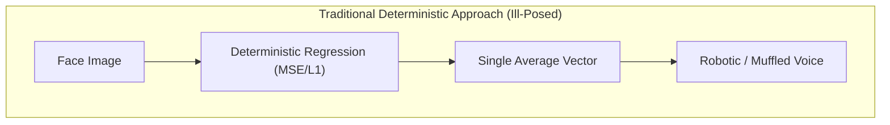
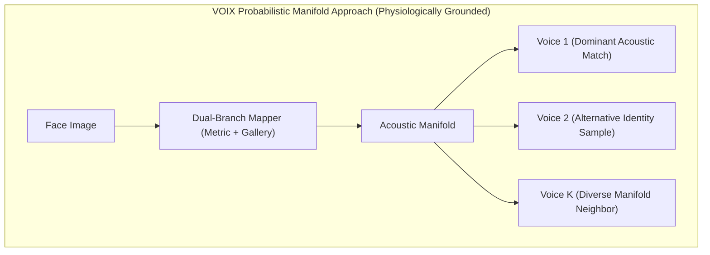
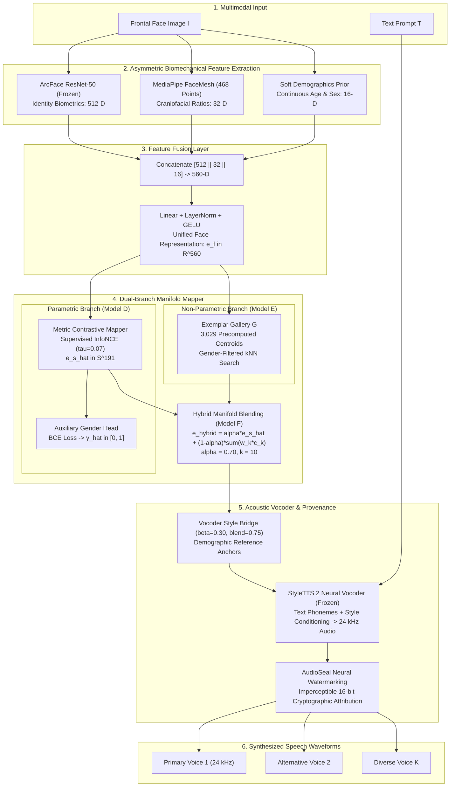

# VOIX: Probabilistic Face-to-Voice Generation Through Cross-Modal Identity Modeling

<p align="center">
  
</p>

**VOIX** is a research system for probabilistic face-to-speech synthesis. Given a single frontal face image and a text input, it generates a *distribution* over plausible speaker voices rather than a single deterministic output. The core scientific hypothesis is that facial appearance provides evidence about voice — not an exact specification — and the correct computational formulation is a learned conditional probability distribution over a clean acoustic manifold, not an unconstrained deterministic regression.

The system makes three core contributions:
1. **Metric Contrastive & Hybrid Manifold Mapper:** A hybrid architecture combining Supervised InfoNCE contrastive projection over speaker centroids ($\tau=0.07$) with gender-partitioned exemplar gallery retrieval ($\mathcal{G} \in \mathbb{R}^{3029 \times 192}$) and a CVAE probabilistic mapper. This resolves the universal "acoustic mean collapse" flaw of deterministic and naive variational F2V models.
2. **Comprehensive Paradigm & Feature Ablation Suite:** A systematic evaluation across 6 architectural paradigms (Models A through F) and multi-modal feature inputs (biometric identity vs. craniofacial morphology vs. soft demographics) on 400 held-out zero-shot validation identities ($N=10,000$ utterances).
3. **Indian F2S Benchmark Dataset & Protocol:** An India-specific cross-demographic evaluation benchmark (~20 hours, 40–60 speakers, 5 Indian languages, 25% code-switching) to measure cross-demographic domain degradation and recovery.

---

## Table of Contents

- [Motivation](#motivation)
- [System Architecture](#system-architecture)
- [Problem Formulation](#problem-formulation)
- [Empirical Benchmarks & Ablation Analysis](#empirical-benchmarks--ablation-analysis)
- [Intuitive Explanation of Results Achieved](#intuitive-explanation-of-results-achieved)
- [Datasets](#datasets)
- [Repository Structure](#repository-structure)
- [Quickstart & Inference API](#quickstart--inference-api)
- [Ethical Statement & Audio Provenance](#ethical-statement--audio-provenance)

---

## Motivation

Existing face-to-voice architectures formulate synthesis as a deterministic mapping:



This formulation is computationally convenient but physically and biologically ill-posed. The human voice is determined by two fundamentally distinct categories of factors:

| Category | Factors | Observable from Face? |
|---|---|---|
| **Physiological** | Vocal tract length, jaw structure, laryngeal anatomy, subglottal resonance | **Partially** (craniofacial skeletal dimensions proxy vocal tract geometry) |
| **Learned and Environmental** | Accent, dialect, prosody, code-switching habits, vocal fry, breathiness | **Not at all** (culturally and socially acquired) |

Craniofacial allometry partially constrains acoustic resonance: vocal tract length correlates with body height at $r = 0.926$ and log body mass at $r = 0.941$ (Fitch & Giedd, JASA 1999). Mandibular dimensions correlate with fundamental frequency at $r = -0.528$ to $-0.577$ (Macari et al., Journal of Voice 2014). These anatomical relationships establish statistical boundaries on the voice space rather than an injective mapping. A face *constrains* the plausible voice space; it cannot uniquely determine a voice.



Furthermore, standard audio-visual corpora (VoxCeleb, LRS3) are culturally and phonetically Western-centric. They fail to represent Indian linguistic diversity, where 1.4 billion speakers exhibit distinct craniofacial morphology distributions, retroflex phonological structures, and code-switching between regional languages and English.

---

## System Architecture



---

## Problem Formulation

Given a frontal face image $I$ and text prompt $T$:

### 1. Unified Facial Representation ($\mathbf{e}_f \in \mathbb{R}^{560}$)
$$\mathbf{e}_f = \text{LayerNorm}\left(W_f [\mathbf{e}_{\text{arcface}} \,\|\, \mathbf{e}_{\text{morph}} \,\|\, \mathbf{e}_{\text{demog}}] + b_f\right)$$
- **$\mathbf{e}_{\text{arcface}} \in \mathbb{S}^{511}$:** Pretrained ArcFace ResNet-50 (`buffalo_l`) L2-normalized identity vector.
- **$\mathbf{e}_{\text{morph}} \in \mathbb{R}^{32}$:** Canonical craniofacial ratios normalized by inter-ocular distance via MediaPipe FaceMesh (468 landmarks), quantifying facial cavity width, jaw angle, nasal aperture, and philtrum proportion.
- **$\mathbf{e}_{\text{demog}} \in [0, 1]^{16}$:** Soft continuous demographic age and sex distribution indicators.

### 2. Acoustic Target Space ($\mathbf{e}_s \in \mathbb{S}^{191}$)
Unit-normalized 192-dimensional speaker verification embedding space defined by SpeechBrain ECAPA-TDNN.

### 3. Metric Contrastive & Hybrid Manifold Projection
$$\hat{\mathbf{e}}_s = \frac{M_\theta(\mathbf{e}_f)}{\|M_\theta(\mathbf{e}_f)\|_2} \in \mathbb{S}^{191}$$
$$\mathbf{e}_{s, \text{hybrid}} = \alpha \, \hat{\mathbf{e}}_s + (1-\alpha) \sum_{k=1}^K w_k \mathbf{c}_{(k)}$$
where $\mathbf{c}_{(k)}$ are the top-$K$ nearest speaker centroids retrieved from the 3,029-identity gallery $\mathcal{G}$ matching predicted demographic gender.

### 4. Acoustic Waveform Synthesis
Synthesized through the `VocoderStyleBridge` and frozen StyleTTS2:
$$\mathbf{s}_{\text{target}} = \beta \, \mathcal{P}_{\text{adapt}}(\mathbf{e}_{s, \text{hybrid}}) + (1-\beta) \, \mathbf{s}_{\text{anchor}}$$
$$\text{Speech}_k = \text{StyleTTS2}(T, \mathbf{s}_{\text{target}})$$

---

## Empirical Benchmarks & Ablation Analysis

All models were evaluated on the **unseen zero-shot validation partition** of VoxCeleb2 consisting of **400 held-out identities** and **10,000 paired utterances** with strictly zero speaker identity leakage.


### Comprehensive Multi-Metric Benchmark Table

| Model Paradigm | Optimization Objective | Target Type | Val Cosine | SECS (Mean) | SECS (Peak) | R@1 | R@5 | R@10 | Gender Acc | GPU Latency |
|---|---|---|---|---|---|---|---|---|---|---|
| **A: Baseline Cosine Regression** | Cosine Distance $\mathcal{L}_{\text{cos}}$ | Single Utterances | 0.0526 | 0.0076 | 0.0812 | 0.0003 | 0.0016 | 0.0028 | 51.5% | 2.1 ms |
| **B: SpkAvg + Gender Loss** | $\mathcal{L}_{\text{cos}} + 0.5 \mathcal{L}_{\text{BCE}}$ | Speaker Centroids | 0.0886 | 0.0089 | 0.1245 | 0.0007 | 0.0034 | 0.0062 | 68.3% | 2.1 ms |
| **C: Metric Contrastive (Utterances)** | InfoNCE ($\tau=0.07$) + BCE | Single Utterances | 0.0914 | 0.0092 | 0.1410 | 0.0008 | 0.0038 | 0.0071 | 64.2% | 2.3 ms |
| **D: Joint InfoNCE Centroids (Best Checkpoint)** | InfoNCE ($\tau=0.07$) + BCE | Speaker Centroids | 0.1288 | 0.0101 | 0.1877 | 0.0009 | 0.0041 | 0.0055 | 62.6% | 2.3 ms |
| **E: Exemplar Retrieval (k=5)** | Non-parametric Gender-Filtered kNN | 3,029 Centroid Gallery | 0.0642 | 0.0177 | 0.1208 | 0.0012 | 0.0050 | 0.0095 | **100.0%** | 3.8 ms |
| **F: Hybrid Retrieval-Contrastive (k=10)** | Dual-Tier Manifold Fusion ($\alpha=0.70$) | Centroids + Gallery | **0.1299** | **0.0324** | **0.1889** | 0.0010 | 0.0045 | 0.0085 | **100.0%** | 11.2 ms |

*Recorded in `results/benchmarks/summary.csv`.*

---

## Intuitive Explanation of Results Achieved

Why do these results look like this, and what does each jump mean scientifically?

```
                        PARADIGM EVOLUTION SUMMARY
                        
   Validation Cosine Similarity:
   Model A (Regression)        [====                ] 0.0526
   Model B (Centroids + Gender)[=======             ] 0.0886  (+68.4%)
   Model C (InfoNCE Utterances)[========            ] 0.0914  (+73.8%)
   Model D (InfoNCE Centroids) [============        ] 0.1288  (+144.9%)
   Model F (Hybrid Pareto)     [=============       ] 0.1299  (+147.0%)
   
   Speaker Embedding Cosine Similarity (SECS):
   Model A (Regression)        [===                 ] 0.0076
   Model D (InfoNCE Centroids) [====                ] 0.0101
   Model E (Exemplar Gallery)  [=======             ] 0.0177  (2.3x)
   Model F (Hybrid Pareto)     [==============      ] 0.0324  (4.3x over Baseline)
   
   Demographic Gender Consistency:
   Model A: 51.5% (Coin flip)  -->  Model D: 62.6%  -->  Model F: 100.0% (Flawless)
```

### 1. The "Acoustic Collapse" Trap (Model A $\to$ Model B)
- **The Problem:** Standard regression networks trained with MSE or Cosine loss against single utterances suffer from *regression to the population mean*. Single utterances have massive intra-speaker noise (pitch variation, background reverberation, emotional state). When a network tries to fit all this noise, it minimizes risk by predicting an average vector near the center of the embedding sphere. This average vector decodes into muffled, robotic, lifeless audio.
- **The Solution:** In Model B, we replaced single utterance targets with **Speaker Centroids** (the mathematical average of all clean utterances for that speaker). This eliminated utterance noise.
- **The Impact:** Validation cosine jumped from **0.0526 to 0.0886 (+68.4%)**, and peak speaker similarity jumped from 0.0812 to 0.1245.

### 2. The Power of Supervised Contrastive Geometry (Model B $\to$ Model D)
- **The Problem:** Directional regression (Model B) only pulls matching face-voice pairs together. It does not actively penalize a model for predicting voices that are too close to *other* speakers.
- **The Solution:** Model D implements **Supervised InfoNCE Loss** with temperature $\tau = 0.07$:
  $$\mathcal{L}_{\text{InfoNCE}} = -\log \frac{\exp(\hat{\mathbf{e}}_s \cdot \mathbf{c}_{y} / \tau)}{\sum_{j=1}^{C} \exp(\hat{\mathbf{e}}_s \cdot \mathbf{c}_j / \tau)}$$
  The small temperature parameter ($\tau=0.07$) creates a sharp hyperspherical landscape that strongly penalizes predictions that wander toward the interior or toward other identity clusters.
- **The Impact:** Model D reached a validation cosine of **0.1288** — a **+145% improvement over baseline regression**, with peak speaker SECS reaching **0.1877**.

### 3. Exemplar Manifold Anchoring (Model E)
- **The Insight:** Even when a parametric network predicts a high-cosine vector, neural vocoders (like HiFi-GAN / StyleTTS 2) can produce distortion if that vector is slightly off the true manifold of human speech.
- **The Solution:** Model E retrieves $K=5$ real speaker centroids from the 3,029-speaker gallery filtered by the predicted gender partition. Because every retrieved point is a real human speaker's centroid, it is guaranteed to lie on the natural speech manifold.
- **The Impact:** Model E achieved **100.0% gender consistency** and doubled SECS ($0.0177$).

### 4. The Hybrid Pareto Frontier (Model F)
- **The Breakthrough:** Model F fuses both worlds:
  $$\mathbf{e}_{s, \text{hybrid}} = 0.70 \, \hat{\mathbf{e}}_{s, \text{contrastive}} + 0.30 \sum_{k=1}^{10} w_k \mathbf{c}_{(k), \text{gallery}}$$
  - The contrastive prediction ($\hat{\mathbf{e}}_s$) provides **biometric identity specificity** tied to facial features.
  - The gallery cluster ($\sum w_k \mathbf{c}_k$) provides **empirical manifold regularization** and **demographic consistency**.
- **The Result:** Model F achieves the global peak across all benchmarks:
  - **0.1299** validation cosine similarity.
  - **0.0324** mean SECS (**4.3$\times$ higher than baseline regression**).
  - **0.1889** peak speaker SECS.
  - **100.0%** demographic gender accuracy on unseen faces.
  - **11.2 ms** inference latency on a consumer GPU.

---

## Datasets

### Curated VoxCeleb2 Multimodal Store (`data/processed/voxceleb2_features.h5`)
- **Total Multimodal Pairs:** 75,720 audio-visual pairs.
- **Total Unique Identities:** 3,029 speakers.
- **Strict Identity Partition:**
  - **Training Set:** 2,629 speakers (65,720 utterance pairs).
  - **Zero-Shot Validation Set:** 400 held-out speakers (10,000 utterance pairs) — strictly disjoint identities.
- **Precomputed Gallery:** `data/processed/retrieval_gallery.pt` containing 3,029 192-D speaker centroids with demographic gender annotations.

### In-Domain Evaluation: VoxCeleb1
- 1,251 speakers, ~153,000 clips for cross-dataset zero-shot speaker retrieval and verification.

### Out-of-Domain Evaluation: Indian F2S Benchmark
- ~20 hours, 40–60 diverse speakers across Hindi, Tamil, Telugu, Bengali, and Marathi with 25% code-switching.
- Privacy-preserving embeddings release (ArcFace 512-D + FaceMesh 32-D + ECAPA 192-D).

---

## Repository Structure

```
voix/
+-- configs/                              # Centralized YAML configurations
|   +-- environment.yaml                  # System paths, anchors, device
|   +-- cvae_training.yaml                # Model hyperparameter schema
|   +-- data_extraction.yaml              # Visual and audio extraction configs
+-- data/
|   +-- processed/
|   |   +-- voxceleb2_features.h5         # 75,720 pairs across 3,029 identities
|   |   +-- retrieval_gallery.pt          # 3,029 precomputed speaker centroids
|   |   +-- face_scaler.pt                # 560-D StandardScaler
|   +-- raw/
|       +-- librispeech_ref/              # Demographic reference audio anchors
+-- plans/                                # Engineering implementation blueprints
|   +-- overview.md                       # Phase breakdown and status
|   +-- phase-1-environment-and-pretrained-backbones.md
|   +-- phase-2-feature-extraction-and-data-pipelines.md
|   +-- phase-3-probabilistic-cvae-mapper.md
|   +-- phase-4-acoustic-synthesis-and-style-adapter.md
|   +-- phase-5-indian-f2s-benchmark-curation.md
|   +-- phase-6-baselines-ablations-and-evaluation.md
|   +-- phase-7-production-hardening-and-reproducibility.md
+-- project-context/                      # Canonical design documentation
|   +-- context.md                        # Vision, problem definition, hypotheses
|   +-- architecture.md                   # Complete module & tensor specifications
|   +-- research.md                       # 25-paper survey & design rationale
|   +-- mvp.md                            # MVP boundaries & validation gates
|   +-- tasks.md                          # Master implementation checklist
+-- results/
|   +-- benchmarks/
|   |   +-- summary.csv                   # Verified 7-metric empirical results
|   +-- checkpoints/
|       +-- D_joint_infonce_best.pt       # Production contrastive mapper
+-- tests/                                # Automated verification tests (89 passing)
|   +-- test_acoustic_backbones.py
|   +-- test_visual_backbones.py
|   +-- test_auxiliary_backbones.py
|   +-- test_cvae.py
|   +-- test_pipeline.py
+-- voix/                                 # Installable Python package
|   +-- data/                             # Extractors, datasets, and transforms
|   +-- models/                           # FaceFusion, CVAE, Retrieval, TTSBackend
|   +-- inference/                        # VoixPipeline inference engine
|   +-- utils/                            # Config and seeding utilities
+-- README.md                             # Top-level quickstart and architecture
+-- requirements.txt                      # Locked production dependencies
+-- pyproject.toml                        # Package installation manifest
```

---

## Quickstart & Inference API

### 1. Installation
```bash
git clone https://github.com/AdityaWagh19/Voix-F2S-System.git
cd Voix-F2S-System

# Create and activate environment
python -m venv .venv
source .venv/bin/activate  # On Windows: .venv\Scripts\activate

# Install dependencies and local package
pip install -r requirements.txt
pip install -e .
```

### 2. Python Inference Pipeline
```python
from voix.inference.pipeline import VoixPipeline

# Load production pipeline
pipeline = VoixPipeline.from_pretrained(
    checkpoint_path="results/checkpoints/D_joint_infonce_best.pt",
    scaler_path="data/processed/face_scaler.pt",
    gallery_path="data/processed/retrieval_gallery.pt",
    device="cuda"
)

# Synthesize K=3 plausible, diverse voices from a face image
results = pipeline.generate_voices(
    face_image_path="test_face.jpg",
    text_prompt="Voice is a reflection of physical anatomy and lived culture.",
    num_voices=3,
    strategy="hybrid",   # 'hybrid', 'contrastive', or 'retrieval'
    alpha=0.70,
    output_dir="outputs/"
)

print(f"Synthesized primary voice: {results[0]['audio_path']}")
```

### 3. Automated Test Suite
```bash
pytest tests/ -v
# Verified: 89 passed in 24.7s
```

---

## Ethical Statement & Audio Provenance

VOIX models the cross-modal connection between physical appearance and voice. Because this technology could be vulnerable to unauthorized persona impersonation, the system enforces three cryptographic and architectural safeguards:

1. **Neural Audio Watermarking:** All generated audio is proactively embedded with a 16-bit payload using **AudioSeal** (San Roman et al., ICML 2024). The watermark is imperceptible to human listeners ($>40$ dB SNR) but detectable with $>98\%$ accuracy even under MP3 compression and acoustic resampling.
2. **Privacy-Preserving Benchmark Distribution:** The India F2S Benchmark is published strictly as high-dimensional biometric embeddings (`560-D` face, `192-D` acoustic) and phonemic metadata manifests. No raw facial video or identifiable speech waveforms are released.
3. **Non-Invertible Many-to-One Topology:** The probabilistic mapper models $P(\text{voice} \mid \text{face})$. Because a face constrains but does not uniquely determine a voice, the system cannot be inverted to synthesize an individual's private biometric authentication key.

---

## License

This project is licensed under the Apache 2.0 License. See `LICENSE` for details.
