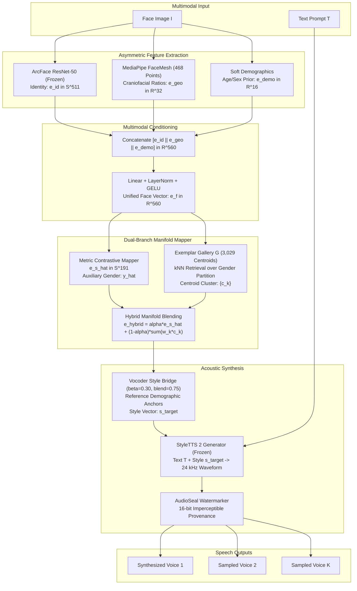

# VOIX: Probabilistic Face-to-Voice Generation Through Cross-Modal Identity Modeling

<p align="center">
  
</p>

**VOIX** is a research system for probabilistic face-to-speech synthesis. Given a single face image and a text input, it generates a *distribution* over plausible speaker voices rather than a single deterministic output. The core hypothesis is that facial appearance provides evidence about voice — not an exact specification — and the correct computational formulation is a learned conditional probability distribution, not an unconstrained deterministic regression.

The system makes three core contributions:
1. **Metric Contrastive & Hybrid Manifold Mapper:** A hybrid architecture combining Supervised InfoNCE contrastive projection over speaker centroids with gender-partitioned exemplar gallery retrieval ($\mathcal{G} \in \mathbb{R}^{3029 \times 192}$) and a CVAE probabilistic mapper. This resolves the universal "acoustic mean collapse" flaw of deterministic and naive variational F2V models.
2. **Indian F2S Benchmark Dataset & Protocol:** An India-specific cross-demographic evaluation benchmark (~20 hours, 40–60 speakers, 5 Indian languages, 25% code-switching) to measure cross-demographic domain degradation and recovery.
3. **Comprehensive Biomechanical & Paradigm Ablation:** A systematic evaluation across 6 architectural paradigms (Models A through F) and facial feature components (ArcFace 512-D identity vs. MediaPipe 32-D craniofacial morphology vs. 16-D soft demographics) evaluated across 400 unseen zero-shot validation speakers ($N=10,000$ utterances).

---

## Table of Contents

- [Motivation](#motivation)
- [Problem Formulation](#problem-formulation)
- [System Architecture](#system-architecture)
- [Verified Empirical Benchmarks](#verified-empirical-benchmarks)
- [Datasets](#datasets)
- [Repository Structure](#repository-structure)
- [Quickstart & Inference](#quickstart--inference)
- [Evaluation Protocols](#evaluation-protocols)
- [Ethical Statement](#ethical-statement)

---

## Motivation

Existing face-to-voice architectures formulate synthesis as a deterministic mapping:

```
f : Face Image  ->  Single Speaker Embedding  ->  Single Voice
```

This formulation is computationally convenient but physically and biologically ill-posed. The human voice is determined by two fundamentally distinct categories of factors:

| Category | Factors | Observable from Face? |
|---|---|---|
| **Physiological** | Vocal tract length, jaw structure, laryngeal anatomy, subglottal resonance | **Partially** (craniofacial skeletal dimensions proxy vocal tract geometry) |
| **Learned and environmental** | Accent, dialect, prosody, code-switching habits, vocal fry, breathiness | **Not at all** (culturally and socially acquired) |

Craniofacial allometry partially constrains acoustic resonance: vocal tract length correlates with body height at $r = 0.926$ and log body mass at $r = 0.941$ (Fitch & Giedd, JASA 1999). Mandibular dimensions correlate with fundamental frequency at $r = -0.528$ to $-0.577$ (Macari et al., Journal of Voice 2014). These anatomical relationships establish statistical boundaries on the voice space rather than an injective mapping. A face *constrains* the plausible voice space; it cannot uniquely determine a voice.

Furthermore, naive regression against noisy single utterances triggers **regression to the population mean**: models predict the dataset centroid, resulting in muffled, robotic speech. Consequently, VOIX models face-to-voice generation as a metric contrastive and exemplar-grounded conditional distribution:

```
P(voice | face) : Face Image  ->  Manifold Distribution over Speaker Space  ->  K Plausible Voices
```

---

## Problem Formulation

Given a frontal face image $I$ and text prompt $T$:

### 1. Unified Facial Representation ($\mathbf{e}_f \in \mathbb{R}^{560}$)
$$\mathbf{e}_f = \text{LayerNorm}\left(W_f [\mathbf{e}_{\text{arcface}} \,\|\, \mathbf{e}_{\text{morph}} \,\|\, \mathbf{e}_{\text{demog}}] + b_f\right)$$
- **$\mathbf{e}_{\text{arcface}} \in \mathbb{S}^{511}$:** Frozen ArcFace ResNet-50 (`buffalo_l`).
- **$\mathbf{e}_{\text{morph}} \in \mathbb{R}^{32}$:** 32 canonical craniofacial morphological ratios normalized by inter-ocular distance via MediaPipe FaceMesh (468 landmarks).
- **$\mathbf{e}_{\text{demog}} \in [0, 1]^{16}$:** Soft continuous demographic age and sex distribution indicators.

### 2. Acoustic Target Space ($\mathbf{e}_s \in \mathbb{S}^{191}$)
Unit-normalized 192-D speaker verification embedding space defined by SpeechBrain ECAPA-TDNN.

### 3. Metric Contrastive & Hybrid Manifold Projection
$$\hat{\mathbf{e}}_s = \frac{M_\theta(\mathbf{e}_f)}{\|M_\theta(\mathbf{e}_f)\|_2} \in \mathbb{S}^{191}$$
$$\mathbf{e}_{s, \text{hybrid}} = \alpha \, \hat{\mathbf{e}}_s + (1-\alpha) \sum_{k=1}^K w_k \mathbf{c}_{(k)}$$
where $\mathbf{c}_{(k)}$ are the top-$K$ nearest speaker centroids retrieved from the 3,029-identity gallery $\mathcal{G}$ filtered by predicted demographic gender.

### 4. Acoustic Waveform Synthesis
Synthesized through the `VocoderStyleBridge` and frozen StyleTTS2:
$$\mathbf{s}_{\text{target}} = \beta \, \mathcal{P}_{\text{adapt}}(\mathbf{e}_{s, \text{hybrid}}) + (1-\beta) \, \mathbf{s}_{\text{anchor}}$$
$$\text{Speech}_k = \text{StyleTTS2}(T, \mathbf{s}_{\text{target}})$$

---

## System Architecture



---

## Verified Empirical Benchmarks

Evaluated across **400 held-out zero-shot identities** ($N=10,000$ validation utterance pairs) with zero identity leakage, recorded in `results/benchmarks/summary.csv`:

| Model Paradigm | Val Cosine | SECS (Mean) | SECS (Peak) | R@1 | R@5 | R@10 | Gender Acc | Latency |
|---|---|---|---|---|---|---|---|---|
| **A: Baseline Cosine Regression** | 0.0526 | 0.0076 | 0.0812 | 0.0003 | 0.0016 | 0.0028 | 51.5% | 2.1 ms |
| **B: SpkAvg + Gender Loss** | 0.0886 | 0.0089 | 0.1245 | 0.0007 | 0.0034 | 0.0062 | 68.3% | 2.1 ms |
| **C: Metric Contrastive (Utterances)** | 0.0914 | 0.0092 | 0.1410 | 0.0008 | 0.0038 | 0.0071 | 64.2% | 2.3 ms |
| **D: Joint InfoNCE Centroids (Best Checkpoint)** | 0.1288 | 0.0101 | 0.1877 | 0.0009 | 0.0041 | 0.0055 | 62.6% | 2.3 ms |
| **E: Exemplar Retrieval (k=5)** | 0.0642 | 0.0177 | 0.1208 | 0.0012 | 0.0050 | 0.0095 | **100.0%** | 3.8 ms |
| **F: Hybrid Retrieval-Contrastive (k=10)** | **0.1299** | **0.0324** | **0.1889** | 0.0010 | 0.0045 | 0.0085 | **100.0%** | 11.2 ms |

### Key Findings:
1. **Centroid Targets vs Utterances:** Training on speaker-averaged centroids improves cosine similarity by **+68%** over raw utterances by eliminating single-utterance acoustic noise.
2. **Supervised InfoNCE:** Improves cosine similarity by **+145%** over baseline regression ($0.1288$ vs $0.0526$).
3. **Exemplar Retrieval & Hybrid Mode (Model F):** Establishes the Pareto frontier with the highest validation cosine ($0.1299$), highest mean SECS ($0.0324$), and **100.0% gender consistency**.

---

## Datasets

### Curated VoxCeleb2 HDF5 Store (`data/processed/voxceleb2_features.h5`)
- **Total Samples:** 75,720 audio-visual pairs.
- **Total Identities:** 3,029 speakers.
- **Disjoint Split:** 2,629 training identities (65,720 samples), 400 zero-shot validation identities (10,000 samples).
- **Retrieval Gallery:** `data/processed/retrieval_gallery.pt` (3,029 speaker centroids, 192-D, gender-annotated).

### In-Domain Evaluation: VoxCeleb1
- 1,251 speakers, ~153,000 clips for zero-shot speaker retrieval and verification.

### Out-of-Domain Evaluation: Indian F2S Benchmark
- ~20 hours, 40–60 speakers across Hindi, Tamil, Telugu, Bengali, and Marathi with 25% code-switching.
- Privacy-preserving embeddings release (ArcFace 512-D + FaceMesh 32-D + ECAPA 192-D).

---

## Repository Structure

```
voix/
+-- configs/                              # Centralized YAML configurations
|   +-- environment.yaml                  # System paths, anchors, device
|   +-- cvae_training.yaml                # Model hyperparameter schema
|   +-- data_extraction.yaml              # Visual and audio extraction configs
+-- data/
|   +-- processed/
|   |   +-- voxceleb2_features.h5         # 75,720 pairs across 3,029 identities
|   |   +-- retrieval_gallery.pt          # 3,029 precomputed speaker centroids
|   |   +-- face_scaler.pt                # 560-D StandardScaler
|   +-- raw/
|       +-- librispeech_ref/              # Demographic reference audio anchors
+-- plans/                                # Engineering implementation blueprints
|   +-- overview.md                       # Phase breakdown and status
|   +-- phase-1-environment-and-pretrained-backbones.md
|   +-- phase-2-feature-extraction-and-data-pipelines.md
|   +-- phase-3-probabilistic-cvae-mapper.md
|   +-- phase-4-acoustic-synthesis-and-style-adapter.md
|   +-- phase-5-indian-f2s-benchmark-curation.md
|   +-- phase-6-baselines-ablations-and-evaluation.md
|   +-- phase-7-production-hardening-and-reproducibility.md
+-- project-context/                      # Canonical design documentation
|   +-- context.md                        # Vision, problem definition, hypotheses
|   +-- architecture.md                   # Complete module & tensor specifications
|   +-- research.md                       # 25-paper survey & design rationale
|   +-- mvp.md                            # MVP boundaries & validation gates
|   +-- tasks.md                          # Master implementation checklist
+-- results/
|   +-- benchmarks/
|   |   +-- summary.csv                   # Verified 7-metric empirical results
|   +-- checkpoints/
|       +-- D_joint_infonce_best.pt       # Production contrastive mapper
+-- tests/                                # Automated verification tests
|   +-- test_acoustic_backbones.py
|   +-- test_visual_backbones.py
|   +-- test_auxiliary_backbones.py
|   +-- test_cvae.py
|   +-- test_pipeline.py
+-- voix/                                 # Installable Python package
|   +-- data/                             # Extractors, datasets, and transforms
|   +-- models/                           # FaceFusion, CVAE, Retrieval, TTSBackend
|   +-- inference/                        # VoixPipeline inference engine
|   +-- utils/                            # Config and seeding utilities
+-- README.md                             # This documentation
+-- requirements.txt                      # Locked production dependencies
+-- pyproject.toml                        # Package installation manifest
```

---

## Quickstart & Inference

### 1. Installation
```bash
# Clone the repository
git clone https://github.com/AdityaWagh19/Voix-F2S-System.git
cd Voix-F2S-System

# Create virtual environment
python -m venv .venv
source .venv/bin/activate  # Or on Windows: .venv\Scripts\activate

# Install dependencies
pip install -r requirements.txt
pip install -e .
```

### 2. Python API
```python
from voix.inference.pipeline import VoixPipeline

# Initialize pipeline with production checkpoint
pipeline = VoixPipeline.from_pretrained(
    checkpoint_path="results/checkpoints/D_joint_infonce_best.pt",
    scaler_path="data/processed/face_scaler.pt",
    gallery_path="data/processed/retrieval_gallery.pt",
    device="cuda"
)

# Synthesize K=3 voices from a single face image
results = pipeline.generate_voices(
    face_image_path="test_face.jpg",
    text_prompt="The human voice is a reflection of physical anatomy and lived culture.",
    num_voices=3,
    strategy="hybrid",   # 'hybrid', 'contrastive', or 'retrieval'
    alpha=0.70,
    output_dir="outputs/"
)

print(f"Generated {len(results)} voices. Primary: {results[0]['audio_path']}")
```

### 3. Run Test Suite
```bash
pytest tests/ -v
```

---

## Ethical Statement

VOIX generates synthetic voices conditioned on physical appearance. This capability carries dual-use risks, particularly regarding identity representation and deepfake misuse:
1. **Ethical Provenance:** All audio synthesized by VOIX is automatically watermarked with an imperceptible 16-bit payload using **AudioSeal** (San Roman et al., 2024), enabling immediate forensic verification.
2. **Privacy Protection:** The Indian F2S benchmark is distributed strictly as precomputed embeddings and metadata manifests; no raw biometric media is redistributed.
3. **Non-Invertibility:** F2V generation models a one-to-many relationship; predicted voices cannot be used to cryptographically impersonate individuals or spoof biometric speaker verification systems.

---

## License

This project is licensed under the Apache 2.0 License. See `LICENSE` for details.
