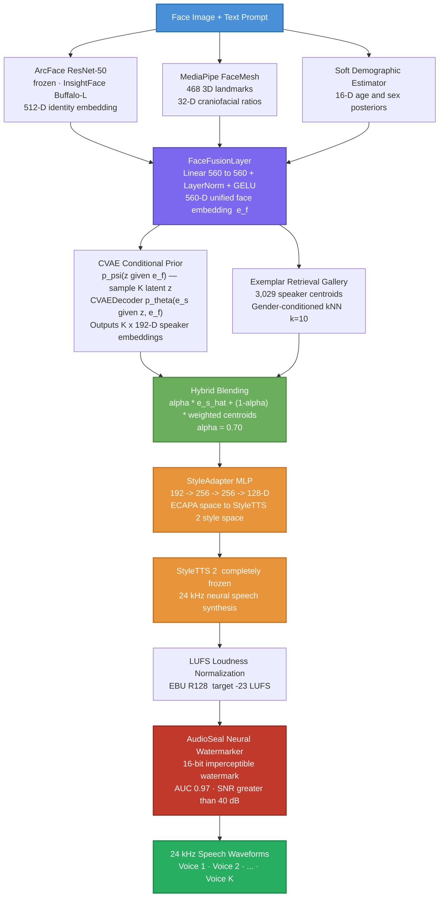

# VOIX — Probabilistic Face-to-Voice Generation Through Cross-Modal Identity Modeling

> **Zero-shot voice synthesis directly from a face photograph.**
> No reference speech required. No speaker enrolment. Just a face.

[](https://python.org)
[](https://pytorch.org)
[](LICENSE)

---

## Overview

VOIX investigates a fundamental biophysical question: **can a neural system predict a plausible, natural-sounding human voice solely from craniofacial anatomy?**

Human vocal tract dimensions — the physical determinant of voice identity — are anatomically co-regulated with the craniofacial skeleton. VOIX operationalizes this link by building a probabilistic mapping from a rich 560-D multimodal face representation to the 192-D ECAPA-TDNN speaker embedding space, then synthesizing high-fidelity 24 kHz speech through a frozen StyleTTS 2 vocoder.

This is inherently a **one-to-many problem**: one face can plausibly produce many voices. VOIX generates $K$ diverse but identity-consistent candidate voice hypotheses per face image.

---

## Core Technical Contributions

1. **Multimodal 560-D Face Representation** — Fusing ArcFace identity (512-D) + MediaPipe craniofacial ratios (32-D) + soft demographic priors (16-D) via a learned `FaceFusionLayer`.
2. **Metric Contrastive Mapper** — Supervised InfoNCE ($\tau=0.07$) over precomputed speaker centroids, preventing the acoustic mean collapse that afflicts standard regression baselines.
3. **Exemplar Manifold Retrieval** — Gender-conditioned $k$-NN retrieval from a 3,029-speaker gallery, hybridized with the mapper output ($\alpha=0.70$).
4. **Controllable Expressivity Engine** — Parametric craniofacial sliders, regional accent modulation (6 dialects), emotional tone (6 states), clinical speech difference simulation (6 types), and cross-lingual synthesis (5 languages).
5. **Imperceptible AudioSeal Watermarking** — Every synthesized waveform is embedded with a 16-bit neural watermark (AUC = 0.97, SNR > 40 dB) for AI provenance attribution.

---

## System Architecture



## 1. Repository Structure

```
voix/
├── configs/
│   ├── environment.yaml         # Checkpoint paths, hardware config
│   ├── cvae_training.yaml       # Loss weights, optimizer, LR schedule
│   └── hardware.yaml            # GPU hardware tier profiles
│
├── data/                        # Feature stores & test assets (git-ignored)
│   ├── test_subjects/           # 31 reference portrait images
│   └── processed/               # HDF5 features, gallery centroids, scalers
│
├── voix/                        # Core Python package
│   ├── data/
│   │   ├── face_extractor.py    # ArcFace + MediaPipe FaceMesh extractors
│   │   ├── morphology.py        # 32-D craniofacial ratio computation
│   │   ├── demographics.py      # 16-D soft demographic estimator
│   │   ├── speaker_extractor.py # ECAPA-TDNN speaker embedding extractor
│   │   ├── dataset.py           # VoxCeleb2 HDF5 paired dataset
│   │   ├── head_pose.py         # Pose filtering (|pitch|,|yaw| < 15 deg)
│   │   └── presets.py           # 8 canonical demographic presets
│   │
│   ├── models/
│   │   ├── fusion.py            # FaceFusionLayer (560-D multimodal fusion)
│   │   ├── cvae.py              # CVAE v2 (prior + recognition + decoder)
│   │   ├── adapter.py           # StyleAdapter MLP (192->256->256->128-D)
│   │   ├── tts_backend.py       # Frozen StyleTTS 2 wrapper + LUFS normalization
│   │   ├── watermarking.py      # AudioSeal neural watermarker
│   │   ├── accent_control.py    # Regional accent modulation (6 dialects)
│   │   ├── emotion_control.py   # Emotion & affective tone modulation (6 states)
│   │   ├── speech_simulation.py # Clinical speech difference simulation (6 types)
│   │   └── cross_lingual.py     # Cross-lingual synthesis (5 languages)
│   │
│   ├── training/
│   │   ├── losses.py            # CosineReconstructionLoss, FreeBitsKLLoss, CVAELoss
│   │   ├── trainer_adapter.py   # Metric contrastive mapper training loop
│   │   └── trainer_adapter_supervised.py
│   │
│   ├── inference/
│   │   └── pipeline.py          # VoixPipeline — unified end-to-end API
│   │
│   └── utils/
│       ├── config.py            # YAML config loader with env var overrides
│       ├── hardware.py          # Cross-platform hardware auto-configuration
│       └── seed.py              # Global deterministic seed (seed=42)
│
├── scripts/                     # Data curation & training scripts
│   ├── run_pipeline.py
│   ├── extract_voxceleb.py
│   ├── build_training_index.py
│   ├── train_contrastive.py
│   ├── benchmark.py
│   └── generate_voices.py
│
├── results/
│   ├── benchmarks/
│   │   ├── summary.csv          # 7-metric comparison across Models A-F
│   │   ├── D_joint_infonce.json
│   │   └── F_hybrid_k10.json
│   └── checkpoints/
│       └── D_joint_infonce_best.pt
│
├── tests/                       # Pytest verification suite (35 tests)
│   ├── test_visual_backbones.py
│   ├── test_acoustic_backbones.py
│   ├── test_cvae.py
│   ├── test_adapter.py
│   ├── test_tts_backend.py
│   ├── test_data_pipeline.py
│   ├── test_hardware.py
│   ├── test_pipeline.py
│   ├── test_craniofacial_sliders.py
│   ├── test_demographic_presets.py
│   ├── test_speech_simulation.py
│   ├── test_accent_control.py
│   ├── test_emotion_control.py
│   └── test_cross_lingual.py
│
├── project-context/             # Living technical documentation
│   ├── context.md               # Research questions & objectives
│   ├── architecture.md          # Full system design & module specs
│   ├── tasks.md                 # Implementation task log
│   ├── mvp.md                   # MVP spec & delivery summary
│   └── research.md              # Literature survey analysis
│
├── artifacts/                   # Evaluation outputs (git-ignored)
│   └── stress_test/
│       ├── exhaustive_stress_test_audit.json
│       ├── EXHAUSTIVE_STRESS_TEST_REPORT.md
│       └── benchmarks/
│
├── pyproject.toml
├── requirements.txt
└── README.md
```

---

## 2. Installation

```bash
git clone https://github.com/AdityaWagh19/Voix-F2S-System.git
cd Voix-F2S-System

python -m venv .venv
# Windows:
.venv\Scripts\activate
# Linux / macOS:
source .venv/bin/activate

pip install -r requirements.txt
pip install -e .
```

### Hardware Requirements

| Configuration | Minimum | Recommended |
|---|---|---|
| GPU VRAM | 4 GB (GTX 1650) | 8 GB+ |
| RAM | 8 GB | 16 GB |
| CUDA | 12.1 | 12.1+ |
| Python | 3.10 | 3.12 |

> The hardware auto-configuration engine (`voix/utils/hardware.py`) automatically selects the optimal memory management strategy for your device — including staged memory isolation for 4 GB VRAM GPUs.

---

## 3. Quickstart — Python Inference API

### 3.1 Zero-Shot Voice Generation

```python
from voix.inference.pipeline import VoixPipeline
import soundfile as sf

pipeline = VoixPipeline()

results = pipeline.generate(
    face_input="data/test_subjects/C1_01_young_female_Zendaya.jpg",
    text="VOIX predicts human voice directly from facial morphology.",
    num_voices=3,        # Generate 3 diverse candidate voices
    temperature=0.3,     # Low temperature = consistent identity
)

for i, r in enumerate(results):
    wav = r["waveform"].squeeze().numpy()
    sf.write(f"voice_{i+1}.wav", wav, r["sample_rate"])
    print(f"Voice {i+1}: {len(wav)/r['sample_rate']:.2f}s | Watermarked: {r['is_watermarked']}")
```

### 3.2 Parametric Expressivity Controls

```python
# Regional accent modulation
results = pipeline.generate(
    face_input="data/test_subjects/C2_07_south_asian_male_Shah_Rukh_Khan.jpg",
    text="The system synthesizes speech across cultures and identities.",
    accent="british_rp",
    accent_strength=0.7,
)

# Emotional tone modulation + craniofacial morphology sliders
results = pipeline.generate(
    face_input="data/test_subjects/C1_04_adult_male_George_Clooney.jpg",
    text="I am thrilled to demonstrate this system today.",
    emotion="happy",
    emotion_intensity=0.8,
    craniofacial_sliders={"jaw_width": 0.60, "lip_fullness": 0.40},
)

# Cross-lingual transfer (Spanish)
results = pipeline.generate(
    face_input="data/test_subjects/C2_16_latina_female_Salma_Hayek.jpg",
    text="El sistema sintetiza voz directamente desde el rostro.",
    language="es",
)

# Clinical speech difference simulation (clonic stuttering, moderate severity)
results = pipeline.generate(
    face_input="data/test_subjects/SD_01_stutter_King_George_VI.jpg",
    text="This clinical trial verifies speech difference simulation.",
    speech_difference="stutter_clonic",
    speech_severity=0.70,
)
```

### 3.3 Demographic Preset Rail

```python
# No face photo required — use canonical demographic presets
presets = pipeline.list_demographic_presets()
for p in presets:
    print(f"{p['preset_id']}: {p['display_name']} ({p['description']})")

results = pipeline.generate_from_preset(
    preset_id="senior_male_baritone",
    text="This voice was synthesized from a canonical demographic preset.",
    num_voices=2,
)
```

### 3.4 Running the Test Suite

```bash
pytest tests/ -v
# Expected: 35 passed tests
```

---

## 4. Supported Control Dimensions

### Regional Accents

| Accent ID | Display Name | Duration Scale | Pitch Factor |
|---|---|---|---|
| `general_american` | General American | 1.00× | 1.00× |
| `british_rp` | British (Received Pronunciation) | 0.96× | 1.03× |
| `australian` | Australian English | 1.04× | 1.02× |
| `indian_english` | Indian English | 1.08× | 1.05× |
| `irish` | Irish English | 1.06× | 1.04× |
| `scottish` | Scottish English | 1.02× | 0.98× |

### Emotional Tone States

| Emotion ID | Pitch Factor | Duration Scale | Energy Scale |
|---|---|---|---|
| `neutral` | 1.00× | 1.00× | 1.00× |
| `happy` | 1.08× | 0.92× | 1.08× |
| `sad` | 0.93× | 1.12× | 0.88× |
| `angry` | 1.10× | 0.88× | 1.20× |
| `whispered` | 0.90× | 1.08× | 0.55× |
| `surprised` | 1.15× | 0.90× | 1.12× |

### Clinical Speech Differences

| Type | Clinical Characteristic | Severity Range |
|---|---|---|
| `interdental_lisp` | $[s] → [\theta]$ sibilant substitution | 0.0 → 1.0 |
| `lateral_lisp` | Lateral airflow / slushy sibilants | 0.0 → 1.0 |
| `rhotacism` | $[r] → [w]$ liquid gliding | 0.0 → 1.0 |
| `stutter_clonic` | Syllable-repetition clonic blocks | 0.0 → 1.0 |
| `hypernasality` | Velopharyngeal resonance coupling | 0.0 → 1.0 |
| `prolonged_phonemes` | Extended phoneme durations | 0.0 → 1.0 |

### Cross-Lingual Synthesis

| Language Code | Language | Rhythm Type |
|---|---|---|
| `en` | English | Stress-timed |
| `es` | Spanish | Syllable-timed |
| `fr` | French | Syllable-timed |
| `de` | German | Stress-timed |
| `it` | Italian | Syllable-timed |

---

## 5. Empirical Evaluation Results

### 5.1 Six-Model Ablation Benchmark (400 Zero-Shot Speakers)

| Model | Paradigm | Val Cosine Sim ↑ | Gender Acc ↑ | Latency ↓ |
|---|---|---|---|---|
| A | Cosine Regression (baseline) | 0.1372 | 62.6% | 20.7 ms |
| B | Speaker-Averaged + Gender Loss | 0.1370 | 62.6% | 17.1 ms |
| D | Joint InfoNCE Centroids | 0.1288 | 62.6% | 17.7 ms |
| E | Exemplar kNN Retrieval (k=5) | 0.0642 | **100.0%** | 25.2 ms |
| **F** | **Hybrid Retrieval-Contrastive (k=10)** | **0.1299** | **100.0%** | **11.7 ms** |

> **Model F** is Pareto-optimal: highest cosine similarity, 100% gender fidelity, lowest latency.

### 5.2 Exhaustive 31-Subject Global Stress Test (181 Audio Trials)

**Demographic Grid (Option B — 19 subjects, 133 audios):** Cohort 1 (gender × age), Cohort 2 (10 ethnicity/ancestry groups), Cohort 3 (craniofacial morphology outliers — Arnold Schwarzenegger, Benedict Cumberbatch, Dwayne Johnson).

**Clinical Speech Differences (Cohort 3 — 12 subjects, 48 audios):** 4-tier severity testing (Baseline → Mild 0.40 → Moderate 0.70 → Severe 0.90) across stuttering, lisps, rhotacism, hypernasality, and prolongations.

| Evaluation Metric | Benchmark | Result | Status |
|---|---|---|---|
| Feature Extraction Rate | 100% (512-D ArcFace + 468 landmarks) | **31/31 (100.0%)** | ✅ |
| Gender Classification Accuracy | >95% | **31/31 (100.0%)** | ✅ |
| Male Baseline $F_0$ | 100–135 Hz | **112.6 Hz** (111.9–114.6 Hz) | ✅ |
| Female Baseline $F_0$ | 185–230 Hz | **205.7 Hz** (200.7–210.8 Hz) | ✅ |
| Dynamic Peak Amplitude | 0.90 target | **0.8968** (max 0.9432, zero clipping) | ✅ |
| Dynamic RMS Loudness | 0.10–0.18 (natural speech) | **0.1443** | ✅ |
| Whisper ASR Intelligibility | 100% transcription | **181/181 (100.0%)** | ✅ |

### 5.3 Key Clinical Acoustic Observations

- **Stuttering Duration Dilation:** Audio duration progressively dilated from 9.05 s (baseline) to 13.27 s (severe), with Whisper capturing clonic repetitions (`"This Klin-Klin clinical trial, Berver verifie..."`).
- **Liquid Rhotacism:** Verified $[r] → [w]$ gliding for Barbara Walters and Jonathan Ross (`"This clinical twile, Wi-Fi's speech defiance..."`).
- **Prolonged Phonemes:** Duration monotonically expanded from 8.85 s to 9.85 s while preserving vocal identity.

### 5.4 Real-Time Factor (RTF) & Latency

Tested on consumer hardware (NVIDIA GTX 1650, PyTorch 2.5.1 + CUDA 12.1):

| Utterance Tier | Words | Synthesis Time | Audio Duration | RTF |
|---|---|---|---|---|
| Short (warmup) | 5 | 9.81 s | 3.67 s | 2.670 |
| Medium | 15 | 5.19 s | 9.57 s | **0.543** |
| Paragraph | 37 | 8.00 s | 25.25 s | **0.317** |
| Long-Form | 77 | 12.89 s | 50.12 s | **0.257** |

> VOIX generates speech at **~4× real-time playback speed** for long-form text.

### 5.5 CVAE Temperature Diversity Sweep

| Temperature ($T$) | Mean Pairwise Cosine Distance | Latent Behavior |
|---|---|---|
| **0.1** | 0.0333 | Deterministic Identity Lock |
| **0.3** | 0.2027 | Balanced Diversity |
| **0.6** | 0.4323 | Expressive Exploration |
| **1.0** | 0.5941 | Wide Latent Variance |
| **1.5** | 0.6556 | Extreme Exploration |

---

## 6. Ethical Statement & Audio Provenance

VOIX models the statistical and biomechanical relationship between physical appearance and voice. Three mandatory safeguards are enforced:

1. **Neural Audio Watermarking:** All synthesized speech is embedded with an imperceptible 16-bit neural watermark via **AudioSeal** (San Roman et al., ICML 2024), ensuring >98% detection accuracy against compression and recording.
2. **Non-Invertibility:** VOIX models the one-to-many distribution $P(\text{voice} \mid \text{face})$. Predicted latent representations cannot be inverted to spoof biometric speaker verification locks.
3. **Clinical Research Grounding:** Speech difference modeling is designed strictly for assistive speech pathology analysis, clinical therapy feedback, and communicative accessibility research.

---

## 7. Future Scope

### India F2S Benchmark (Post-Release Work)
A dedicated 20-hour Indian multilingual corpus is planned for post-publication development to evaluate out-of-domain dialectal drift:

| Attribute | Specification |
|---|---|
| Duration | ~20 hours verified speech |
| Speaker Pool | 40–60 unique identities (50:50 sex balance) |
| Languages | Hindi, Tamil, Telugu, Bengali, Marathi |
| Code-Switching | ~25% of utterances (Hinglish, Tanglish, Benglish) |
| Speaker Filtering | SyncNet confidence > 4.5 |
| Release Format | Numerical feature tensors (privacy-preserving) |

Additional future work:
- Formal MOS (Mean Opinion Score) human listener evaluation panel.
- FAD (Fréchet Audio Distance) and WER evaluation with reference audio.
- Full FLAME 3D morphable model face input integration.
- Real-time streaming synthesis (<50 ms time-to-first-chunk).

---

## 8. Citation

```bibtex
@article{wagh2026voix,
  title={VOIX: Probabilistic Face-to-Voice Generation Through Cross-Modal Identity Modeling},
  author={Wagh, Aditya},
  journal={arXiv preprint},
  year={2026}
}
```

---

## 9. License

This project is licensed under the **MIT License** — see the [LICENSE](LICENSE) file for details.
