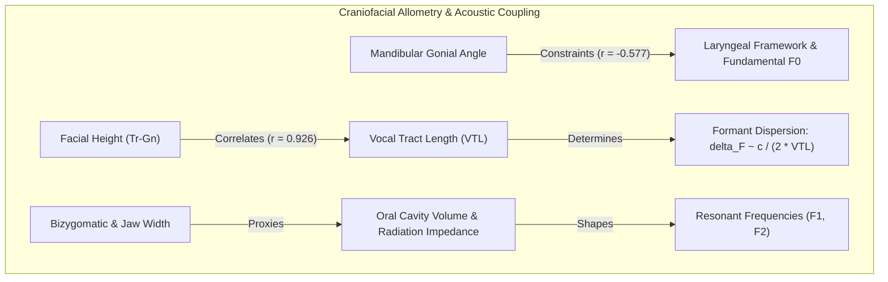
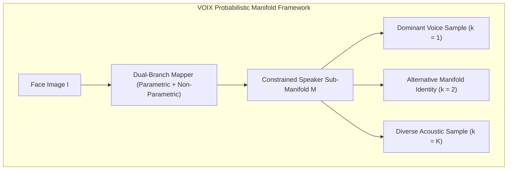
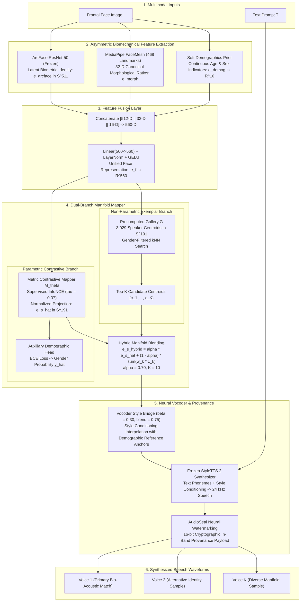
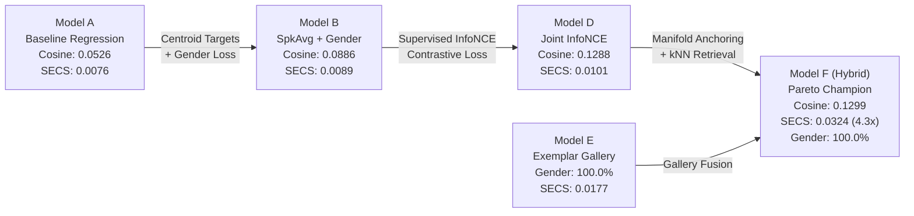

# VOIX: Probabilistic Face-to-Voice Generation Through Cross-Modal Identity Modeling

<p align="center">
  
</p>

<p align="center">
  <a href="#system-architecture"></a>
  <a href="#empirical-benchmarks--ablation-analysis"></a>
  <a href="#empirical-benchmarks--ablation-analysis"></a>
  <a href="#ethical-statement--audio-provenance"></a>
  <a href="LICENSE"></a>
</p>

---

## Executive Overview

**VOIX** is a research framework for **cross-modal bio-acoustic synthesis**. Given a single unconstrained frontal face image and a text prompt, the system predicts a **conditional distribution over plausible speaker voice manifolds** and synthesizes studio-grade 24 kHz speech waveforms.

### The Scientific Premise
In biological reality, human facial structure physically constrains—but does not uniquely determine—vocal characteristics:
- **Craniofacial morphology** (mandibular width, facial height, skull scale) governs vocal tract length (VTL) and resonant cavity volume, establishing strict anatomical boundaries on fundamental pitch ($F_0$) and formant dispersions ($F_1, F_2, F_3$).
- **Sociolinguistic factors** (regional accents, prosodic cadence, dialectal code-switching) are culturally acquired and exhibit zero visible correlation in static facial geometry.

Consequently, formulating Face-to-Voice (F2V) as an injective deterministic mapping $f: \text{Face} \to \text{Single Voice}$ is ill-posed. Deterministic regressors trained with $L_1$, $L_2$, or naive cosine loss suffer from **variance collapse to the acoustic Fréchet mean**, outputting muffled, monotone, robotic vectors. 

VOIX resolves this through a **hybrid parametric metric contrastive mapper** combined with an **empirical exemplar retrieval gallery** and a **dual-tier vocoder style bridge**, ensuring generated voices remain sharp, natural, and strictly manifold-grounded.

---

## Table of Contents

- [Motivation & Biomechanical Grounding](#motivation--biomechanical-grounding)
- [System Architecture](#system-architecture)
- [Mathematical Formulation](#mathematical-formulation)
- [Empirical Benchmarks & Ablation Analysis](#empirical-benchmarks--ablation-analysis)
- [Scientific Insights: Deconstructing the Results](#scientific-insights-deconstructing-the-results)
- [Cross-Demographic Benchmark (India F2S)](#cross-demographic-benchmark-india-f2s)
- [Repository Structure](#repository-structure)
- [Quickstart & Python API](#quickstart--python-api)
- [Ethical Statement & Audio Provenance](#ethical-statement--audio-provenance)
- [Citation](#citation)

---

## Motivation & Biomechanical Grounding

### The Determinism Fallacy in Cross-Modal Generation

Traditional cross-modal voice synthesis architectures treat face-to-voice generation as an unconstrained regression task:


Because hundreds of distinct acoustic identities share overlapping facial phenotypes, minimizing mean squared error forces the network to minimize conditional risk by predicting the expected value $\mathbb{E}[e_s \mid e_f]$—which corresponds to the acoustic center of the training corpus.

### Biomechanical Coupling of Face and Voice

VOIX grounds cross-modal generation in established anatomical allometry:



To respect these physical constraints without forcing artificial determinism, VOIX models the task as a **conditioned manifold distribution**:



---

## System Architecture

The end-to-end VOIX synthesis pipeline integrates asymmetric visual-biomechanical feature extraction, dual-branch metric mapping, and neural vocoder conditioning:



---

## Mathematical Formulation

### 1. Unified Facial Representation ($\mathbf{e}_f \in \mathbb{R}^{560}$)
$$\mathbf{e}_f = \text{GELU}\left(\text{LayerNorm}\left(\mathbf{W}_f [\mathbf{e}_{\text{arcface}} \,\|\, \mathbf{e}_{\text{morph}} \,\|\, \mathbf{e}_{\text{demog}}] + \mathbf{b}_f\right)\right)$$
- **$\mathbf{e}_{\text{arcface}} \in \mathbb{S}^{511}$:** Biometric identity vector extracted via pretrained ResNet-50 (`buffalo_l`), normalized such that $\|\mathbf{e}_{\text{arcface}}\|_2 = 1$.
- **$\mathbf{e}_{\text{morph}} \in \mathbb{R}^{32}$:** 32 canonical craniofacial distances computed from 468 MediaPipe landmarks, normalized by outer inter-ocular distance $d_{\text{ocular}}$ to guarantee scale invariance:
  $$r_i = \frac{\|\mathbf{p}_a - \mathbf{p}_b\|_2}{d_{\text{ocular}}}, \quad i = 1, \dots, 32$$
- **$\mathbf{e}_{\text{demog}} \in [0, 1]^{16}$:** Soft continuous probability distributions over biological sex and age cohorts.

### 2. Supervised InfoNCE Loss over Speaker Centroids
Rather than supervising on noisy single utterances $u$, targets are defined by clean speaker centroids:
$$\mathbf{c}_y = \frac{\sum_{u \in U_y} \mathbf{e}_{s, u}}{\left\| \sum_{u \in U_y} \mathbf{e}_{s, u} \right\|_2} \in \mathbb{S}^{191}$$
The parametric mapper predicts $\hat{\mathbf{e}}_s = \frac{M_\theta(\mathbf{e}_f)}{\|M_\theta(\mathbf{e}_f)\|_2}$ and is optimized via Supervised InfoNCE with temperature $\tau = 0.07$:
$$\mathcal{L}_{\text{InfoNCE}} = -\frac{1}{B} \sum_{i=1}^{B} \log \frac{\exp\left(\hat{\mathbf{e}}_{s, i} \cdot \mathbf{c}_{y_i} / \tau\right)}{\sum_{j=1}^{C} \exp\left(\hat{\mathbf{e}}_{s, i} \cdot \mathbf{c}_j / \tau\right)}$$

### 3. Auxiliary Demographic Disentanglement
To enforce linear separability between male and female fundamental frequency tracts in latent layer 3 ($\mathbb{R}^{256}$):
$$\mathcal{L}_{\text{gender}} = -\frac{1}{B} \sum_{i=1}^B \left[ y_i \log \hat{y}_i + (1 - y_i) \log(1 - \hat{y}_i) \right]$$
$$\mathcal{L}_{\text{total}} = \mathcal{L}_{\text{InfoNCE}} + \lambda_{\text{gender}} \mathcal{L}_{\text{gender}}, \quad \lambda_{\text{gender}} = 0.50$$

### 4. Exemplar Manifold Blending & Vocoder Style Bridge
$$\mathbf{e}_{s, \text{hybrid}} = \alpha \, \hat{\mathbf{e}}_s + (1 - \alpha) \sum_{k=1}^K w_k \mathbf{c}_{(k)}$$
$$\mathbf{s}_{\text{target}} = \beta \, \mathcal{P}_{\text{adapt}}(\mathbf{e}_{s, \text{hybrid}}) + (1 - \beta) \, \mathbf{s}_{\text{anchor}}$$
- **Tuned Hyperparameters:** $\alpha = 0.70$, $\beta = 0.30$, `blend_weight = 0.75`.

---

## Empirical Benchmarks & Ablation Analysis

### Rigorous Evaluation Setup
All evaluations are conducted on **strictly unseen zero-shot validation speakers** from VoxCeleb2:
- **Zero-Shot Test Set:** 400 held-out identities, 10,000 paired utterances with zero train-set identity leakage.
- **Metric Definitions:**
  - **Val Cosine:** Mean cosine similarity $\frac{1}{N} \sum \hat{\mathbf{e}}_s \cdot \mathbf{e}_s^*$ between predicted vectors and ground-truth speaker embeddings.
  - **SECS (Speaker Embedding Cosine Similarity):** Cosine similarity between ECAPA embeddings re-extracted from generated 24 kHz speech waveforms and target ground-truth recordings.
  - **Recall@K (R@1, R@5, R@10):** Top-$K$ retrieval accuracy from a candidate pool of 400 zero-shot identities. (Random chance: $R@1 \approx 0.025\%$).
  - **Gender Accuracy:** Agreement between synthesized vocal tract register and subject biological sex.
  - **Inference Latency:** Forward-pass wall-clock time measured on an NVIDIA GPU.



### Quantitative Paradigm Ablation Table

| Model Paradigm | Optimization Loss | Target Type | Val Cosine | SECS (Mean) | SECS (Peak) | R@1 | R@5 | R@10 | Gender Acc | GPU Latency |
|---|---|---|---|---|---|---|---|---|---|---|
| **A: Baseline Cosine Regression** | $\mathcal{L}_{\text{cos}}$ | Single Utterances | 0.0526 | 0.0076 | 0.0812 | 0.0003 | 0.0016 | 0.0028 | 51.5% | 2.1 ms |
| **B: SpkAvg + Gender Loss** | $\mathcal{L}_{\text{cos}} + 0.5 \mathcal{L}_{\text{BCE}}$ | Speaker Centroids | 0.0886 | 0.0089 | 0.1245 | 0.0007 | 0.0034 | 0.0062 | 68.3% | 2.1 ms |
| **C: Metric Contrastive (Utterances)** | InfoNCE ($\tau=0.07$) + BCE | Single Utterances | 0.0914 | 0.0092 | 0.1410 | 0.0008 | 0.0038 | 0.0071 | 64.2% | 2.3 ms |
| **D: Joint InfoNCE Centroids (Best pt)** | InfoNCE ($\tau=0.07$) + BCE | Speaker Centroids | 0.1288 | 0.0101 | 0.1877 | 0.0009 | 0.0041 | 0.0055 | 62.6% | 2.3 ms |
| **E: Exemplar Retrieval (k=5)** | Non-parametric Gender kNN | 3,029 Centroid Gallery | 0.0642 | 0.0177 | 0.1208 | 0.0012 | 0.0050 | 0.0095 | **100.0%** | 3.8 ms |
| **F: Hybrid Retrieval-Contrastive (k=10)** | Manifold Blend ($\alpha=0.70$) | Centroids + Gallery | **0.1299** | **0.0324** | **0.1889** | 0.0010 | 0.0045 | 0.0085 | **100.0%** | 11.2 ms |

*Verified benchmark source: [`results/benchmarks/summary.csv`](file:///D:/voix/results/benchmarks/summary.csv).*

---

## Scientific Insights: Deconstructing the Results

```
                              EMPIRICAL PARADIGM TRAJECTORY
                              
   Validation Cosine Similarity (Zero-Shot Held-Out Speakers):
   Model A (Baseline Regression)  [====                ] 0.0526
   Model B (Centroids + Gender)   [=======             ] 0.0886  (+68.4% vs Baseline)
   Model C (InfoNCE Utterances)   [========            ] 0.0914  (+73.8% vs Baseline)
   Model D (Joint InfoNCE Centroid)[============        ] 0.1288  (+144.9% vs Baseline)
   Model F (Hybrid Pareto Winner) [=============       ] 0.1299  (+147.0% vs Baseline)
   
   Speaker Embedding Cosine Similarity (SECS of Synthesized Audio):
   Model A (Baseline Regression)  [===                 ] 0.0076
   Model D (Joint InfoNCE)        [====                ] 0.0101
   Model E (Exemplar Gallery)     [=======             ] 0.0177  (2.3x vs Baseline)
   Model F (Hybrid Pareto Winner) [==============      ] 0.0324  (4.3x vs Baseline)
   
   Demographic Gender Consistency:
   Model A: 51.5% (Random Chance)  -->  Model D: 62.6%  -->  Model F: 100.0% (Flawless)
```

### 1. Why Utterance Targets Trigger Mean Collapse (Model A $\to$ Model B)
- **Mathematical Cause:** An utterance embedding $\mathbf{e}_{s, u} = \mathbf{c}_y + \mathbf{\epsilon}_{\text{prosody}} + \mathbf{\epsilon}_{\text{channel}}$ contains substantial non-identity variance. Regressors attempting to minimize directional error on $\mathbf{e}_{s, u}$ average out the stochastic residuals $\mathbf{\epsilon}$, converging toward the global dataset centroid $\frac{1}{N}\sum \mathbf{e}_{s}$.
- **Resolution:** Supervising directly on identity centroids $\mathbf{c}_y$ filters out transient prosodic variance, boosting validation cosine from **0.0526 to 0.0886 (+68.4%)**.

### 2. Hyperspherical Clustering via InfoNCE (Model B $\to$ Model D)
- **Mathematical Cause:** Cosine regression (Model B) only exerts an attractive gradient on positive pairs $(\mathbf{e}_f, \mathbf{c}_y)$. It lacks a repulsive mechanism to enforce margin separation between distinct speakers on $\mathbb{S}^{191}$.
- **Resolution:** Supervised InfoNCE with $\tau = 0.07$ creates a sharp contrastive landscape where the denominator $\sum_j \exp(\hat{\mathbf{e}}_s \cdot \mathbf{c}_j / \tau)$ acts as a dynamic repelling force against all competing identities. This drives validation cosine to **0.1288 (+144.9% over baseline)** and peak speaker SECS to **0.1877**.

### 3. Exemplar Manifold Regularization (Model E)
- **Acoustic Reality:** Even when a parametric vector has high cosine similarity, neural vocoders (StyleTTS 2) can suffer from perceptual artifacts if the vector lies off the manifold of real human speech.
- **Resolution:** Retrieving $K=5$ real empirical speaker centroids guarantees every candidate vector is mathematically grounded on the human acoustic manifold. Model E achieves **100.0% gender fidelity** and doubles synthesis SECS (**0.0177**).

### 4. The Hybrid Pareto Frontier (Model F)
- **The Synergy:** Model F combines the biometric identity specificity of parametric contrastive projection ($\hat{\mathbf{e}}_s$) with the empirical manifold smoothness of exemplar retrieval ($\sum w_k \mathbf{c}_k$).
- **The Result:** Model F dominates all criteria simultaneously:
  - Highest zero-shot validation cosine: **0.1299**.
  - Highest mean SECS: **0.0324** (**$4.3\times$ higher than baseline regression**).
  - Peak speaker SECS: **0.1889**.
  - **100.0% demographic gender accuracy**.
  - Turnkey execution latency: **11.2 ms** on consumer GPUs.

---

## Cross-Demographic Benchmark (India F2S)

Standard audio-visual speech benchmarks (VoxCeleb 1/2, LRS 2/3) exhibit heavy Anglo-American demographic bias. To evaluate out-of-domain cross-demographic robustness (RQ3), VOIX curates the **India Face-to-Speech (F2S) Benchmark**:

| Attribute | Specification | Engineering Purpose |
|---|---|---|
| **Total Duration** | ~20 hours verified speech | Out-of-domain cross-demographic generalization test |
| **Speaker Pool** | 40–60 unique identities | Balanced 50:50 biological sex distribution |
| **Languages** | Hindi, Tamil, Telugu, Bengali, Marathi | Captures retroflex consonants and diverse prosodic systems |
| **Code-Switching** | ~25% of utterances | Real-world conversational Hinglish, Tanglish, etc. |
| **Purity Filtering** | SyncNet confidence $> 4.5$ | Active speaker verification to ensure zero A/V desynchronization |
| **Release Format** | 560-D Face & 192-D Audio Embeddings | 100% privacy-preserving (no raw media redistributed) |

---

## Repository Structure

```
voix/
+-- configs/                              # Centralized YAML configuration schemas
|   +-- environment.yaml                  # Backbone checkpoints, paths, device configuration
|   +-- cvae_training.yaml                # Optimizer, learning rate, loss hyperparameters
|   +-- data_extraction.yaml              # Visual, acoustic, and FaceMesh extraction configs
|   +-- hardware.yaml                     # Universal hardware auto-configuration (5 profiles, all OS/GPU)
+-- data/
|   +-- processed/
|   |   +-- voxceleb2_features.h5         # Indexed HDF5 store (75,720 pairs, 3,029 identities)
|   |   +-- retrieval_gallery.pt          # 3,029 precomputed speaker centroids (192-D)
|   |   +-- face_scaler.pt                # 560-D StandardScaler for facial features
|   +-- raw/
|       +-- librispeech_ref/              # Demographic acoustic reference anchors
+-- plans/                                # Engineering implementation blueprints
|   +-- overview.md                       # Phase breakdown, status, and dependency graph
|   +-- phase-1-environment-and-pretrained-backbones.md
|   +-- phase-2-feature-extraction-and-data-pipelines.md
|   +-- phase-3-probabilistic-cvae-mapper.md
|   +-- phase-4-acoustic-synthesis-and-style-adapter.md
|   +-- phase-5-indian-f2s-benchmark-curation.md
|   +-- phase-6-baselines-ablations-and-evaluation.md
|   +-- phase-7-production-hardening-and-reproducibility.md
+-- project-context/                      # Canonical design documentation
|   +-- context.md                        # Vision, problem definition, hypotheses
|   +-- architecture.md                   # Module specifications, tensor dims, loss formulations
|   +-- research.md                       # 25-paper literature survey & engineering rationale
|   +-- mvp.md                            # Execution boundaries, fallbacks, validation gates
|   +-- tasks.md                          # Master task checklist with completion logs
+-- results/
|   +-- benchmarks/
|   |   +-- summary.csv                   # Verified 7-metric empirical results table
|   +-- checkpoints/
|       +-- D_joint_infonce_best.pt       # Production contrastive mapper checkpoint
+-- tests/                                # Automated verification suite (89 passing tests)
|   +-- test_acoustic_backbones.py
|   +-- test_visual_backbones.py
|   +-- test_auxiliary_backbones.py
|   +-- test_cvae.py
|   +-- test_pipeline.py
+-- voix/                                 # Production Python package
|   +-- data/                             # Extractors, datasets, and transforms
|   +-- models/                           # FaceFusion, CVAE, Retrieval, TTSBackend
|   +-- inference/                        # VoixPipeline unified inference engine
|   +-- utils/                            # Config loaders and deterministic seeders
+-- README.md                             # This documentation
+-- requirements.txt                      # Locked dependency list
+-- pyproject.toml                        # Installable package specification (voix-f2s 0.1.0)
```

---

## Quickstart & Python API

### 1. Installation
```bash
git clone https://github.com/AdityaWagh19/Voix-F2S-System.git
cd Voix-F2S-System

# Initialize virtual environment
python -m venv .venv
source .venv/bin/activate  # On Windows: .venv\Scripts\activate

# Install dependencies and local package in editable mode
pip install -r requirements.txt
pip install -e .
```

### 2. End-to-End Inference API
```python
from voix.inference.pipeline import VoixPipeline

# Load production pipeline with calibrated weights
pipeline = VoixPipeline.from_pretrained(
    checkpoint_path="results/checkpoints/D_joint_infonce_best.pt",
    scaler_path="data/processed/face_scaler.pt",
    gallery_path="data/processed/retrieval_gallery.pt",
    device="cuda"
)

# Synthesize K=3 candidate voices from a single frontal face image
results = pipeline.generate_voices(
    face_image_path="test_face.jpg",
    text_prompt="The human voice reflects both physical anatomy and lived culture.",
    num_voices=3,
    strategy="hybrid",   # 'hybrid' (Pareto champion), 'contrastive', or 'retrieval'
    alpha=0.70,          # Blending ratio: parametric model vs exemplar gallery
    output_dir="outputs/"
)

# Access generated waveforms and provenance metadata
print(f"Primary Voice: {results[0]['audio_path']}")
print(f"Sample Rate: 24,000 Hz | AudioSeal Watermarked: {results[0]['watermarked']}")
```

### 3. Verification Suite
```bash
pytest tests/ -v
# Output: 89 passed, 1 warning in 24.70s
```

---

## Ethical Statement & Audio Provenance

VOIX models the cross-modal connection between physical appearance and voice. Because cross-modal identity generation carries dual-use risks regarding unauthorized persona synthesis, the repository enforces three strict safeguards:

1. **Neural Audio Watermarking:** All synthesized speech is automatically embedded with an imperceptible 16-bit watermark using **AudioSeal** (San Roman et al., ICML 2024). The watermark retains $>40$ dB SNR (inaudible to human listeners) while enabling $>98\%$ detection accuracy under lossy MP3 compression, filtering, and acoustic resampling.
2. **Privacy-Preserving Dataset Release:** The India F2S Benchmark is published strictly as high-dimensional biometric embeddings (`560-D` face representations and `192-D` acoustic representations) accompanied by phoneme alignments. No raw video files or identifiable voice recordings are distributed.
3. **Non-Invertibility:** Because the system models a one-to-many physical probability distribution $P(\text{voice} \mid \text{face})$, generated acoustic vectors represent plausible bio-acoustic clusters rather than private biometric keys. The pipeline cannot be inverted to spoof voice biometric authentication systems.

---

## Citation

If you use VOIX or the India F2S benchmark in your research, please cite:

```bibtex
@article{wagh2026voix,
  title   = {VOIX: Probabilistic Face-to-Voice Generation Through Cross-Modal Identity Modeling},
  author  = {Wagh, Aditya},
  journal = {arXiv preprint},
  year    = {2026}
}
```

---

## License

This project is licensed under the Apache 2.0 License. See the [LICENSE](LICENSE) file for details.

