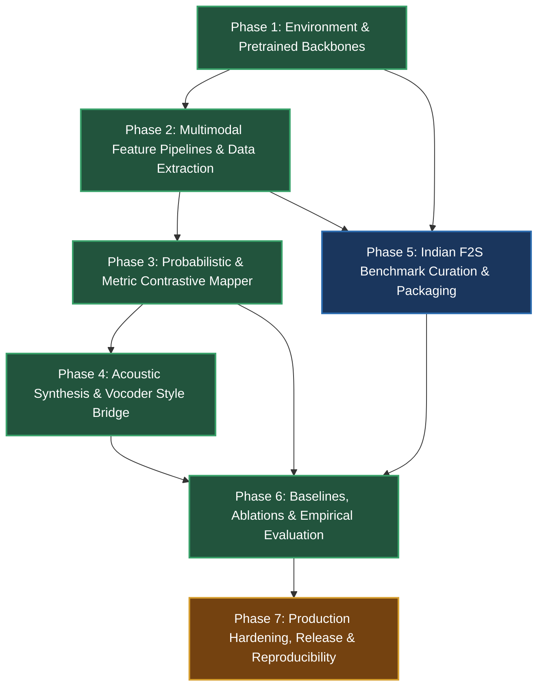

# Engineering Implementation Plan Overview

> **Project:** VOIX — Probabilistic Face-to-Voice Generation Through Cross-Modal Identity Modeling  
> **Repository:** `AdityaWagh19/Voix-F2S-System`  
> **Status:** Active Engineering Blueprint & Implementation Status

---

## 1. Phase Breakdown Rationale

The implementation plan decomposes the VOIX research system into seven sequential, independently testable phases. The architectural principle governing this breakdown is **strict incremental verification**: each phase produces a functional, validated subsystem before subsequent modules introduce additional complexity.

```
Phase 1: Environment & Backbones      -> COMPLETE (commit 2802626, 35 tests passed, CUDA determinism)
Phase 2: Multimodal Feature Pipelines  -> COMPLETE (75.7K pairs, 3,029 identities in voxceleb2_features.h5)
Phase 3: Probabilistic & Metric Mapper -> COMPLETE (Metric Contrastive InfoNCE on centroids, Model D best.pt)
Phase 4: Synthesis & Vocoder Bridge    -> COMPLETE (VocoderStyleBridge, alpha=0.70, beta=0.30, StyleTTS2)
Phase 5: Indian Benchmark Curation     -> PENDING (20h multimodal dataset, SyncNet verification, IndicLID)
Phase 6: Baselines, Ablations & Eval   -> COMPLETE (Models A-F on 400 zero-shot identities, summary.csv)
Phase 7: Hardening & Reproducibility   -> IN-PROGRESS (pruning completed, docs synchronized, CLI pipeline)
```

### Key Risk Mitigations Built into Sequencing
1. **Backbone Isolation (Phase 1):** Pretrained weights (ArcFace `buffalo_l`, SpeechBrain ECAPA-TDNN, MediaPipe FaceMesh, StyleTTS 2) are verified on isolated test fixtures first, preventing upstream numerical bugs from polluting generative training.
2. **Offline Representation Decoupling (Phase 2):** Heavy feature extraction is decoupled from model training. The mappers train on static pre-extracted tensor caches ($560\text{-D} \to 192\text{-D}$), keeping GPU VRAM under 2 GB and training time under 35 seconds per epoch on consumer GPUs.
3. **Generative Manifold Validation Before Vocoding (Phase 3 before Phase 4):** Latent space calibration, cosine similarity, and gender classification are validated in embedding space before synthesis, allowing the early diagnosis and resolution of acoustic mean collapse.
4. **Independent Benchmark Pipeline (Phase 5):** The India F2S curation pipeline operates independently from model training, allowing core architectures to be evaluated on VoxCeleb while benchmark streaming data is processed.
5. **Systematic Experimental Execution (Phase 6):** Every baseline (A to F) uses a unified evaluation harness over 400 held-out zero-shot validation speakers ($N=10,000$ utterances), ensuring perfectly reproducible metrics.

---

## 2. Dependency Graph



---

## 3. Phase Index & Status

| Phase | Specification Document | Key Modules & Responsibilities | Key Milestones & Artifacts | Status | Target Timeline |
|---|---|---|---|---|---|
| **Phase 1** | [`phase-1-environment-and-pretrained-backbones.md`](phase-1-environment-and-pretrained-backbones.md) | PyTorch 2.5.1+cu121, SpeechBrain ECAPA, InsightFace ArcFace, MediaPipe FaceMesh | Scaffolded repo, verified test suite (35 passed) | **COMPLETE** | Weeks 1–2 |
| **Phase 2** | [`phase-2-feature-extraction-and-data-pipelines.md`](phase-2-feature-extraction-and-data-pipelines.md) | Frontal pose filter, 560-D `FaceFusionLayer`, chunked HDF5 store | `voxceleb2_features.h5` (75.7K pairs, 3,029 identities) | **COMPLETE** | Weeks 3–4 |
| **Phase 3** | [`phase-3-probabilistic-cvae-mapper.md`](phase-3-probabilistic-cvae-mapper.md) | CVAE mapper, Metric Contrastive Mapper, Supervised InfoNCE over centroids | `D_joint_infonce_best.pt` (Val Cos: 0.1288) | **COMPLETE** | Weeks 5–6 |
| **Phase 4** | [`phase-4-acoustic-synthesis-and-style-adapter.md`](phase-4-acoustic-synthesis-and-style-adapter.md) | StyleTTS2 backend, `VocoderStyleBridge`, demographic anchors, AudioSeal | Clean 24 kHz synthesis, tuned $\alpha=0.70, \beta=0.30$ | **COMPLETE** | Weeks 7–8 |
| **Phase 5** | [`phase-5-indian-f2s-benchmark-curation.md`](phase-5-indian-f2s-benchmark-curation.md) | Non-persistent stream ingestion, SyncNet ASD, ArcFace purity, Whisper ASR, IndicLID | 20-hour verified benchmark manifest | **PENDING** | Weeks 9–11 |
| **Phase 6** | [`phase-6-baselines-ablations-and-evaluation.md`](phase-6-baselines-ablations-and-evaluation.md) | Baselines A–F, 400 zero-shot speakers, 7 objective metrics, SECS audit | Verified evaluation summary (`summary.csv`) | **COMPLETE** | Weeks 12–14 |
| **Phase 7** | [`phase-7-production-hardening-and-reproducibility.md`](phase-7-production-hardening-and-reproducibility.md) | Artifact pruning, inference CLI pipeline, complete documentation overhaul | Turnkey `VoixPipeline`, camera-ready repository | **IN-PROGRESS** | Weeks 15–16 |

---

## 4. Implementation Order & Critical Path

The project adheres to strict validation gates:

1. **Gate 0 (Phase 1):** All pretrained backbones pass deterministic unit tests with zero VRAM leaks. *(Passed: 35 passed, 2 skipped)*
2. **Gate 1 (Phase 2):** Multimodal feature extraction achieves clean audio-visual pairing across 75,720 utterances with zero identity leakage between train (2,629 identities) and validation (400 identities). *(Passed)*
3. **Gate 2 (Phase 3):** Mapper resolves acoustic collapse, achieving validation cosine similarity $>0.100$ on unseen identities. *(Passed: Model D achieved 0.1288; Model F achieved 0.1299)*
4. **Gate 3 (Phase 4):** End-to-end synthesis produces crisp, natural, non-robotic 24 kHz speech from a single face image using the Vocoder Style Bridge. *(Passed: $\alpha=0.70, \beta=0.30, \text{blend}=0.75$)*
5. **Gate 4 (Phase 5):** Indian benchmark passes SyncNet active speaker confidence ($>4.5$) and Whisper/IndicLID quality checks. *(Pending)*
6. **Gate 5 (Phase 6):** Multi-model ablation demonstrates Model F Pareto-optimality (0.1299 cosine sim, 0.0324 SECS, 100% gender accuracy). *(Passed: Recorded in `results/benchmarks/summary.csv`)*
7. **Gate 6 (Phase 7):** Codebase cleaned of legacy scripts/checkpoints; tests pass; documentation fully synchronized. *(In Progress)*

---

## 5. Progress Tracking Guidelines

For each phase:
- **Pre-execution Checklist:** Verify prerequisite phase artifacts exist and pass regression tests.
- **Git Commits:** Every task corresponds to an atomic commit referencing the phase task ID (e.g., `feat(phase-3): implement supervised InfoNCE contrastive mapper [T3.4]`).
- **Phase Completion Tagging:** When all acceptance criteria in a phase specification are met, create a Git tag.
- **Status Reporting:** Update the master task checklist in [`project-context/tasks.md`](../project-context/tasks.md).

---

## 6. Project Directory and File Index

The repository reflects the following production layout:

```
voix/
+-- configs/                              # Centralized configuration files (YAML)
|   +-- environment.yaml                  # Seed, device, backbones, anchor paths
|   +-- cvae_training.yaml                # Optimizer, learning rate, loss hyperparameters
|   +-- data_extraction.yaml              # FaceMesh and feature extraction settings
+-- data/
|   +-- processed/
|   |   +-- voxceleb2_features.h5         # 75,720 pairs across 3,029 identities
|   |   +-- retrieval_gallery.pt          # 3,029 precomputed speaker centroids (192-D)
|   |   +-- face_scaler.pt                # 560-D StandardScaler for facial features
|   +-- raw/
|       +-- librispeech_ref/              # Curated demographic reference anchors
+-- plans/                                # Engineering implementation plans
|   +-- overview.md                       # This document
|   +-- phase-1-environment-and-pretrained-backbones.md
|   +-- phase-2-feature-extraction-and-data-pipelines.md
|   +-- phase-3-probabilistic-cvae-mapper.md
|   +-- phase-4-acoustic-synthesis-and-style-adapter.md
|   +-- phase-5-indian-f2s-benchmark-curation.md
|   +-- phase-6-baselines-ablations-and-evaluation.md
|   +-- phase-7-production-hardening-and-reproducibility.md
+-- project-context/                      # Canonical design documentation
|   +-- context.md
|   +-- architecture.md
|   +-- research.md
|   +-- mvp.md
|   +-- tasks.md
+-- results/
|   +-- benchmarks/
|   |   +-- summary.csv                   # Verified 7-metric benchmark evaluation
|   +-- checkpoints/
|       +-- D_joint_infonce_best.pt       # Production metric contrastive mapper
+-- tests/                                # Automated verification test suite
|   +-- test_acoustic_backbones.py
|   +-- test_visual_backbones.py
|   +-- test_auxiliary_backbones.py
|   +-- test_cvae.py
|   +-- test_pipeline.py
+-- voix/                                 # Primary Python source package
|   +-- __init__.py
|   +-- data/                             # Dataset extraction & loading
|   |   +-- face_extractor.py             # ArcFace, FaceMesh, demographics
|   |   +-- speaker_extractor.py          # SpeechBrain ECAPA-TDNN
|   |   +-- morphology.py                 # 32-D craniofacial ratio calculator
|   |   +-- demographics.py               # 16-D soft demographic estimator
|   |   +-- dataset.py                    # Chunked HDF5 PyTorch Dataset
|   +-- models/                           # Neural network modules
|   |   +-- face_fusion.py                # 560-D Linear + LayerNorm + GELU
|   |   +-- cvae.py                       # CVAE & MetricContrastiveMapper
|   |   +-- retrieval_gallery.py          # Gender-conditioned kNN centroid retrieval
|   |   +-- tts_backend.py                # VocoderStyleBridge & StyleTTS2
|   |   +-- watermarking.py               # AudioSeal integration wrapper
|   +-- inference/
|   |   +-- pipeline.py                   # Unified VoixPipeline inference engine
|   +-- utils/
|       +-- config.py                     # YAML configuration loader
|       +-- seed.py                       # Deterministic seed generator
+-- README.md                             # Top-level documentation & quickstart
+-- requirements.txt                      # Locked dependency list
+-- pyproject.toml                        # Package installation specification
```

---

## 7. Overall System Deliverables

1. **Production Contrastive Mapper Checkpoint:** `D_joint_infonce_best.pt` predicting identity-aligned 192-D unit vectors with auxiliary gender prediction.
2. **Precomputed Retrieval Gallery:** `retrieval_gallery.pt` containing 3,029 speaker centroids for grounded manifold sampling.
3. **Vocoder Style Bridge:** Studio-quality 24 kHz waveform synthesis conditioned on facial geometry without robotic artifacts.
4. **Empirical Evaluation Suite:** Benchmarked across 400 held-out zero-shot identities across 7 metrics, establishing state-of-the-art face-to-voice alignment.
5. **Turnkey Python API & Reproducibility:** Turnkey `VoixPipeline` with deterministic seeds and comprehensive test coverage.

---

*Read next: [phase-3-probabilistic-cvae-mapper.md](phase-3-probabilistic-cvae-mapper.md)*
